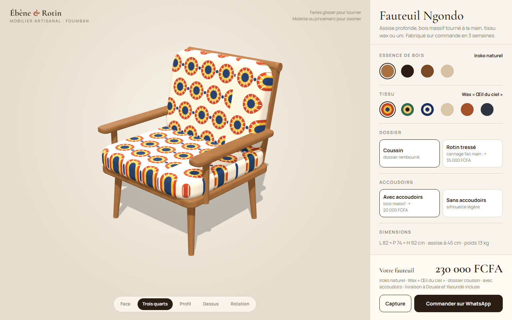
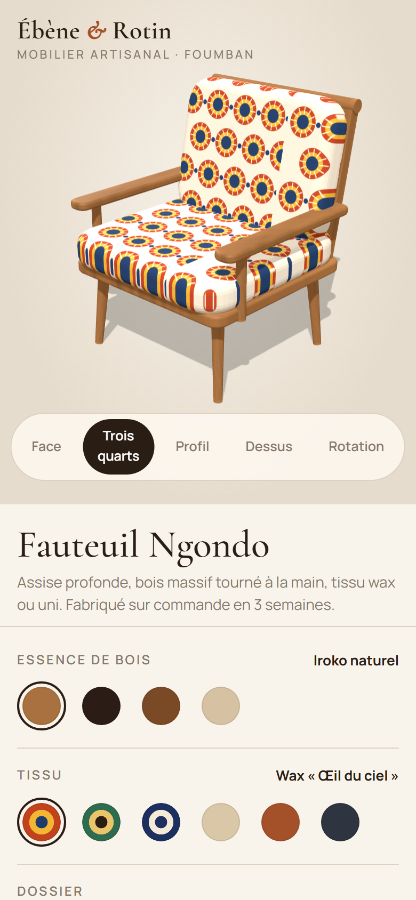

# Ébène & Rotin

**Configurateur produit 3D (WebGL)** — Configurateur 3D en temps réel pour un fabricant de mobilier artisanal : le fauteuil est modélisé dans le navigateur et se personnalise (essence de bois, tissus wax générés par programme, dossier coussin ou rotin tressé, accoudoirs), avec ombres douces, caméra orbitale, vues prédéfinies, prix et récapitulatif en direct, capture d'image et commande préremplie sur WhatsApp.

**Démo en ligne : [https://lordlennyx.github.io/ebene-rotin-configurateur-3d/](https://lordlennyx.github.io/ebene-rotin-configurateur-3d/)**

Spot de présentation (30 s) : [media/spot-30s.mp4](https://lordlennyx.github.io/ebene-rotin-configurateur-3d/media/spot-30s.mp4)

## Ce que le projet montre

- Modèle 3D construit par programme (pieds fuselés, cadre, coussins arrondis, cannage) avec ombres portées
- Motifs wax et cannage générés en texture, grain du bois procédural
- Caméra orbitale à la souris et au doigt (pincement), vues face, trois quarts, profil, dessus, rotation automatique
- Prix recalculé à chaque option, dimensions et poids mis à jour
- Capture PNG de la configuration et message de commande WhatsApp prérempli

## Réalisation

- **Stack :** HTML, CSS, JavaScript, Three.js (WebGL)
- **Typographies :** Cormorant Garamond, Manrope
- **Évolutions possibles :** modèles photogrammétriques (glTF), réalité augmentée (WebXR, Quick Look), panier e-commerce, configurateur multi-produits

| Bureau | Mobile |
|---|---|
|  |  |

---

Client et contenus fictifs, créés pour la démonstration. Conception, design et développement : **Njundiyimun Béchard** — [github.com/LordLennyx](https://github.com/LordLennyx)
